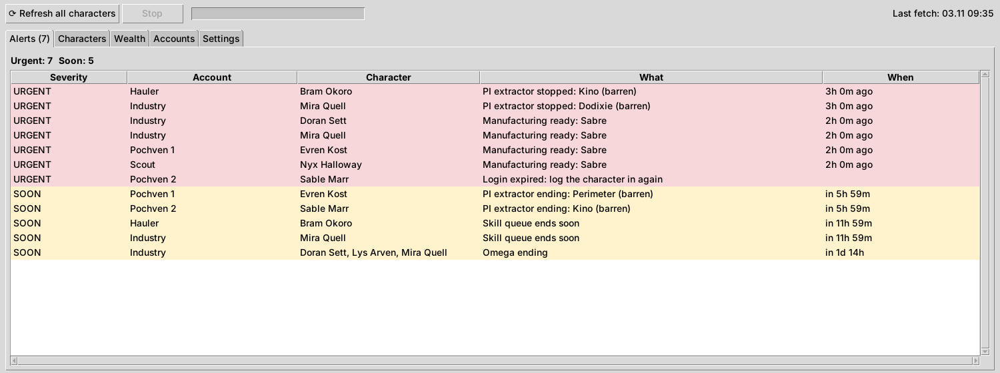
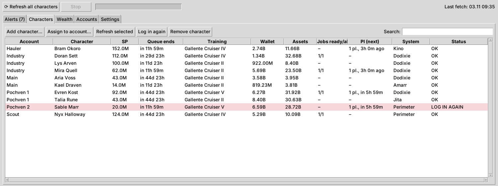

# EveAccounts

[](https://github.com/EasyK0/EveAccounts/actions/workflows/ci.yml)
[](https://github.com/EasyK0/EveAccounts/releases)
[](https://www.python.org/)
[](LICENSE)

A local, encrypted desktop app for people who run many EVE Online accounts. It keeps account credentials in an encrypted vault and puts every character's skills, wallet, assets, industry jobs and planetary colonies in one sortable table. It also lists what needs your attention today.

- **Local only.** All data stays in a SQLite file on your PC. There is no server, no cloud and no telemetry.
- **Official API only.** It talks to CCP's ESI and SSO, and never touches the game client.
- **Standard library only.** Pure Python 3.11+ with Tkinter: nothing to `pip install` to run it.



## Features

| Tab | What it shows |
|---|---|
| **Alerts** | Empty or paused skill queues, queues ending within 24 h, finished industry jobs, stopped or expiring PI extractors, Omega ending soon, and characters whose login has expired |
| **Characters** | SP, queue end, current skill, wallet, asset value, jobs, PI and location for every character, with search |
| **Wealth** | Total ISK and asset value across all characters, plus a "where is my Sabre?" search that shows the item, character, account and station |
| **Accounts** | Login, password, e-mail, e-mail password, Omega date and notes. Searchable, with one-click copy. CSV import/export, or paste a list in almost any format |
| **Settings** | EVE application, refresh interval, parallel downloads, language (English / Polish) |


<sub>Screenshots use generated demo data.</sub>

## Security model

Account passwords and character refresh tokens are the sensitive data here, so they're handled carefully:

- **Two keys are needed to decrypt.** Secrets are encrypted with Windows **DPAPI**, using a key derived from your **master password** (PBKDF2-HMAC-SHA256, 300,000 iterations, random salt) as extra entropy. Reading them takes both your Windows login *and* the master password. A copied database file is useless on another PC or account.
- **No password is stored.** Only a salted verifier, compared in constant time.
- **The clipboard is cleaned up.** Copied passwords are kept out of the Windows clipboard history (Win+V) and cloud clipboard sync, and cleared after 30 seconds.
- **SSO follows best practice.** OAuth 2.0 Authorization Code with **PKCE** and a random `state`. The one-shot callback server binds to `127.0.0.1` only. You can use the app without a client secret.
- **Least privilege.** It only requests read scopes, plus `esi-planets.manage_planets.v1`, which ESI requires to *read* colony details.
- **The repo stays clean.** A CI job fails if a database, CSV export or account list is ever committed.

> The master password cannot be recovered. Back up your accounts with **Export CSV** and keep the file somewhere safe, such as a password manager or an encrypted drive. Exported CSVs with passwords are plain text.

## Getting started

Requires Windows 10/11 and [Python 3.11+](https://www.python.org/downloads/).

1. Download the [latest release](https://github.com/EasyK0/EveAccounts/releases) and unpack it.
2. Run `start.bat`. Use `start-z-konsola.bat` instead to keep a console window open for error output.
3. Choose a master password.
4. Create an application at [developers.eveonline.com](https://developers.eveonline.com/applications):
   - **Connection type:** Authentication & API Access, with the scopes listed in the Settings tab (there is a copy button),
   - **Callback URL:** `http://localhost:8765/callback`,
   - paste the **Client ID** into Settings and save.
5. Add accounts by importing a CSV (see [`konta-przyklad.csv`](konta-przyklad.csv)), pasting a list, or typing them in by hand.
6. Add characters: select an account, click **Add character to account…** and log in. Use the incognito link to switch between accounts, so SSO doesn't reuse the previous login. After that, tokens refresh automatically.

Data is fetched on demand and every 30 minutes while the app is open. Requests run in parallel (6 by default) and respect ESI's error-limit headers, so the first fetch for 300+ characters takes a few minutes.

## Architecture

```
evekonta/
├── gui.py       Tkinter UI (tabs, dialogs, background refresh queue)
├── sync.py      Per-character fetch: skills, queue, wallet, location, jobs, PI, assets; thread pool
├── net.py       ESI client: retries, Retry-After, error-limit back-off, paging
├── sso.py       EVE SSO: PKCE, token exchange/refresh, localhost callback server
├── crypto.py    Vault: DPAPI + PBKDF2 master key
├── storage.py   SQLite schema and queries (WAL mode, thread-safe)
├── reports.py   Alerts, totals, "where is" search
├── csvio.py     CSV and free-form account list import/export
├── clip.py      Win32 clipboard writes excluded from history and cloud sync
└── i18n.py      English/Polish strings
```

The network layer takes a pluggable transport. The tests use it to run the whole flow (SSO, token refresh, ESI paging, retries, sync and alerts) against fake responses, without touching the network.

## Development

```sh
pip install -e .[dev]
pytest
ruff check .
```

CI runs the tests on Windows with Python 3.11 and 3.13, along with the lint and private-file checks.

## License

[MIT](LICENSE). EVE Online and the EVE logo are trademarks of CCP hf. This project is not affiliated with or endorsed by CCP.
